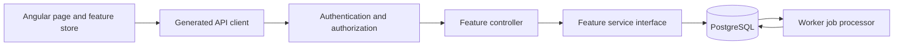

# Architecture guide

## Solution boundaries

The solution is a modular monolith with two backend processes. The API accepts requests; the Worker executes persistent jobs. Both share PostgreSQL and the implementation library. The Angular application is a separate client, built and served by Nginx in Compose.

```text
src/
  Meridian.Api/
    Controllers/           HTTP routes, binding, authorization and status codes
    Authentication/        Seeded demo identity adapter using ASP.NET authentication
    Middleware/            Correlation IDs and safe exception responses
    Program.cs             Host composition and request pipeline
    openapi.json           API contract used to generate the Angular client
  Meridian.Infrastructure/
    Features/
      Imports/
        Contracts/         IImportService and import operation results
        Services/          Upload, duplicate detection and history queries
        Processing/        CSV parsing, normalization, validation and promotion
      Conflicts/
        Contracts/         IConflictService and decision requests/results
        Services/          Audited decisions and deferred revalidation
      Votes/
        Contracts/         IVoteService and position requests/results
        Services/          Vote queries, timeline and optimistic position edits
      PdfImports/          Contracts, extraction/validation processing and human review services
      Snapshots/
        Contracts/         ISnapshotService and selection/publication requests/results
        Services/          Selection capture, results and publication
        Processing/        Background ranking calculation
    BackgroundJobs/        Shared throttled progress reporting
    Persistence/           Database bootstrap, seed and interrupted-job recovery
    Migrations/            Versioned SQL schema and database invariants
    Storage/               File storage contract, local and Azure Blob adapters
    Identity/              Seeded user lookup
    Configuration/         Optional Azure Key Vault configuration
    DependencyInjection.cs Shared service registrations
  Meridian.Worker/
    Program.cs             Host composition and optional telemetry
    Worker.cs              Ownership, recovery, scheduling and shutdown
  Meridian.Web/
    src/app/features/      Imports, review, positions and snapshots
                           Each owns its page, template and state store
    src/app/shared/        Presentation helpers and per-store request feedback
    src/app/workspace.store.ts  Navigation, initialization and progress polling
    src/app/api.service.ts     Facade over the generated OpenAPI client
    src/app/generated-api/     Generated transport types and operations
```

Namespaces match backend folders. Related contracts, services and processing code live under the same feature. Request/result records and public service interfaces have separate named files. The physical storage adapters have separate files as well.

## Request flow



For example, `ImportsController` binds the multipart upload, identifies the caller and maps its result to HTTP 200 or 202. `IImportService` owns upload orchestration, source storage, content-hash deduplication and persistent job creation. `Worker` claims work; `CsvImportJobProcessor` stages rows, and `CsvImportValidator` validates and promotes them. The UI polls persistent progress through the API.

`VotesController` enforces the Admin policy for position edits. `VoteService` checks the expected version and owns the transaction that inserts a new version and audit event. The controller maps a stale result to HTTP 409 and includes the current position.

## Controllers and services

ASP.NET Core supports both Minimal APIs (routes registered with `MapGet`/`MapPost`) and controller APIs (classes with route attributes and actions). Both support dependency injection, middleware, authorization and asynchronous I/O. This project now uses controllers to make the HTTP boundary easy to navigate during review. Actions use constructor-injected feature interfaces and standard MVC results. Shared ProblemDetails responses include a correlation ID.

Services expose explicit read-response records rather than object-based interfaces; JSON field names remain stable and live HTTP payloads are checked against OpenAPI. Services implement application use cases with direct Npgsql access. Their SQL and transactions stay together so that atomic promotion, concurrent decisions, version pointers and publication locking remain explicit. Processing classes contain background workflows and grouped SQL. A generic repository would obscure these operations; the current interfaces describe actual application use cases.

The shared assembly is deliberately named `Infrastructure` in the existing solution, and contains both application orchestration and persistence. This is a packaging trade-off for this assignment. Namespaces and interfaces separate responsibilities within it; they do not enforce separate application/domain assemblies. If independent teams or multiple persistence implementations make that separation useful, contracts and use cases can move to an Application project and pure rules to a Domain project. Transaction ownership needs to remain explicit during that change.

## State and operational boundaries

Each Angular feature store owns its selected records, paging, form validation, busy state and errors. Import report requests carry a selection/filter generation so late detail, row or page responses cannot overwrite another report; polling preserves loaded history and suppresses overlapping refreshes. Snapshot history has stable paging and publication-period/status filters. TypeScript strict mode and Angular strict templates are enabled. Shared presentation/request code creates state per store instance. The shell coordinates refresh/polling and displays feedback from the active screen. Review explicitly refreshes import reports after a decision. Snapshot request counters continue to reject late contribution responses.

The API and Worker run independently. One Worker holds a PostgreSQL ownership lock before startup recovery; scaling to multiple active Workers requires leases/fencing. Progress writes use separate short transactions. Existing database constraints and immutable-version protections remain in the SQL migrations. Authentication uses seeded demo users for the assignment; production identity requires replacing that adapter and its credential handling.

## Verification

The isolated PostgreSQL suite starts real API and Worker processes and checks imports, decisions, versions, snapshot calculations, progress, publication races, HTTP contracts, role restrictions and crash recovery. Angular tests include contribution response races and state isolation between screens. `VERIFICATION.md` records executed checks and distinguishes historical scale measurements from this structural refactor.

## PDF bonus boundary

`PdfImportsController` and `PdfImportService` persist source uploads and versioned review drafts. `PdfExtractionJobProcessor` calls the configured `IDocumentAnalysisClient`, persists its operation reference/raw result, and invokes deterministic layout parsing and domain checks. The draft stays in `AwaitingReview`. Approving locks its version and creates the CSV import/job and audit record in one PostgreSQL transaction. The CSV promoter itself keeps its existing transaction boundary and rules. Reviewed/rejected PDF records are protected by a database immutability trigger.

`ImportService` shares a prepared-import enqueue method for that transaction; ordinary CSV file storage remains before its database transaction, as before. PDF originals use the same local/Blob adapter with a PDF extension. The Worker alternates fairly between CSV, snapshot and PDF queues. PDF service calls have a deadline; startup recovery preserves the operation URL. The two PDF components live within the existing Imports and Review screens and share a dedicated feature store.

## Snapshot capture boundary

Request-time validation and provisional vote rows support immediate feedback and queued UI counts. They are not the final input freeze. At calculation time, the Worker re-evaluates the stored selection, checks positions, replaces provisional vote/version rows and reads country ballots and membership from one repeatable-read transaction. The capture timestamp, contributions, results and completion are committed together. Interrupted attempts roll back and capture a new consistent view on recovery; completed snapshots never recapture. Progress uses a separate table/connection and remains visible during the transaction.

Snapshot contribution details and publication conflicts use a shared native dialog component. Contribution requests keep the snapshot/country identity guards and are invalidated on dialog close. Errors for detail loading are shown in the dialog; publication 409 responses require an explicit subsequent replacement action. The native modal supplies background isolation, focus trapping and Escape handling.
